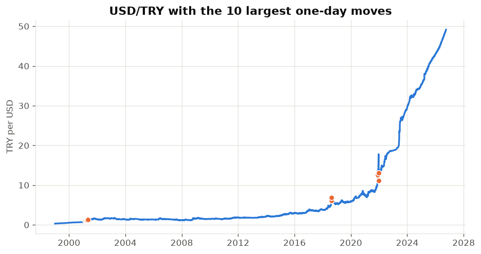
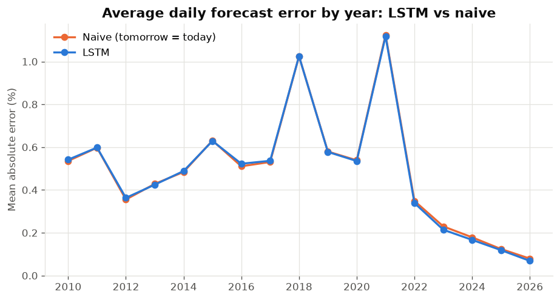
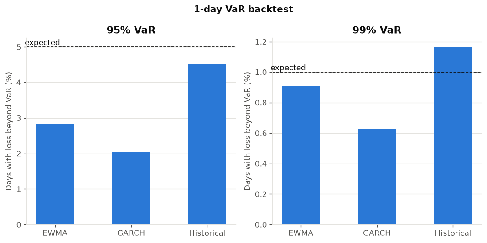
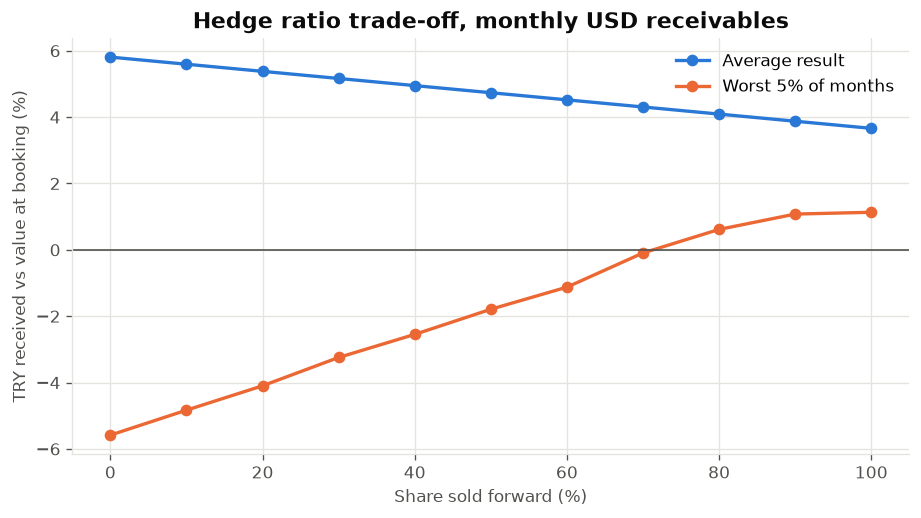

# USD/TRY Currency Risk & Hedging Tool

**The question:** a Turkish exporter is paid in US dollars and converts them to
lira. If the lira strengthens before the dollars arrive, it receives fewer
lira. Can we predict where USD/TRY goes next, how much could be lost, and
does selling dollars in advance (a forward hedge) help?

**The short answers:**

1. **Daily direction isn't forecastable.** A neural network (LSTM) did no
   better than simply assuming the rate keeps rising.
2. **Risk can be measured, even if direction can't.** Simple, well-tested
   methods give a usable estimate of how much a USD 1,000,000 receivable could
   lose.
3. **Hedging trades average gain for certainty.** Over 16 years, selling the
   dollars forward earned less on average than waiting, but no month ended
   below the booking-day value, against 40 of 193 months without a hedge.

Everything here is computed from a fixed, committed data snapshot (ECB rates
up to 2026-10-02), and every model is compared with a simple baseline on
exactly the same days. Details and full tables are in
[docs/methodology.md](docs/methodology.md).

## 1. Twenty-seven years of USD/TRY



From 1999-01-04 to 2026-10-02 (7,106 trading days) USD/TRY went from 0.3158
to 49.1448. Most of the time the lira weakened slowly, but a few single days
moved a lot. The ten largest one-day moves fall in three episodes:
February to May 2001, August 2018, and November to December 2021. The largest
fall for an exporter was on 2021-12-21: USD/TRY dropped 26.74% in one day.

## 2. Can we forecast tomorrow's rate? Not better than a simple trend rule

We trained an LSTM (a type of neural network for sequences) to forecast the
next day's rate. To keep the test fair, it was retrained each year using only
past data, and then scored on the following year. It was compared with two
simple rules on the same 4,290 days (2010-01-04 to 2026-10-02):

- **Naive:** tomorrow's rate equals today's.
- **Drift:** tomorrow's rate moves by the average daily change so far.

| Forecast | Average daily error | Direction right |
|---|---:|---:|
| LSTM | 0.4927% | 58.1% |
| Naive (tomorrow = today) | 0.4946% | n/a |
| Drift (average change so far) | 0.4916% | 58.5% |

USD/TRY rose on 58.5% of these days, so always saying "up" is right 58.5% of
the time. The LSTM got the direction right 58.1% of the time, which is not better.
Year by year, its average error is almost identical to the naive rule's:



A statistical test (Diebold-Mariano) confirms this. Compared with the drift
rule, the LSTM's errors are not significantly different on either measure.
Compared with the naive rule, its squared errors are significantly smaller
(p = 0.0194), but its absolute errors are not (p = 0.1603). In plain terms,
the LSTM learned the lira's average trend and nothing more.

**What this means for the client:** don't base hedging decisions on a daily
forecast. Manage the risk instead.

## 3. How much could a USD 1,000,000 receivable lose?

Value at Risk (VaR) answers: "On all but the worst 1 day in 100, how much could
we lose?" Three methods were used: **historical** (look at the actual worst
days of the last 500), **EWMA** (recent volatility, weighted toward the latest
days) and **GARCH** (a standard volatility model).

On 2026-10-02, with USD/TRY at 49.1448, the 99% VaR for USD 1,000,000 was:

| Method | Next day | Next 21 trading days |
|---|---:|---:|
| Historical | TRY 128,301 | no loss in recent history* |
| EWMA | TRY 126,833 | TRY 578,540 |
| GARCH | TRY 462,066 | TRY 4,584,094 |

\* USD/TRY rose over every one of the last 480 overlapping 21-day periods, so
recent history contains no losing month for an exporter. That is a feature of
a calm period, not a guarantee.

**Did these estimates hold up in the past?** Each method was run day by day
from 2010 to 2026 (4,289 days), using only data available at the time, and
we counted how often the actual loss was bigger than the VaR:



- **Historical VaR** was close to the target at both levels: 4.52% of days at
  95% (target 5%) and 1.17% at 99% (target 1%). The test accepts both.
- **EWMA** was about right at 99% (0.91% of days) but too cautious at 95%.
- **GARCH** was too cautious at both levels: it overstates risk, which is why
  its numbers above are so much larger.

**What this means for the client:** for day-to-day limits, the historical and
EWMA figures are the credible ones. GARCH overstates risk on this data.

## 4. Does hedging help?

We simulated an exporter that books a USD 1,000,000 receivable at the end of
every month, paid three months later: 193 receivables, booked from 2010-06-30
to 2026-06-30. On the booking day it can sell some of the dollars forward at a
rate fixed that day. Results are shown as the lira received compared with the
receivable's value on the booking day.



| Strategy | Average result | Variability | Worst 5% of months |
|---|---:|---:|---:|
| No hedge | +5.81% | 9.81% | −5.58% |
| 50% forward | +4.73% | 5.10% | −1.79% |
| 100% forward | +3.66% | 3.05% | +1.13% |
| Dynamic (100% when volatility is high, else 50%) | +4.47% | 4.10% | +0.28% |

- **Not hedging earned the most on average** because the lira usually
  weakened by more than the forward rate already assumed. It also had the
  widest spread and the worst months.
- **Hedging fully gave up 2.15 percentage points of average gain**, but none
  of its 193 months ended below the booking-day value. Without a hedge, 40
  did.
- **The worst 5% turns positive between 70% and 80% hedged** (−0.09% at 70%,
  +0.62% at 80%, ratios tested in steps of 10%).
- **Hedging beat not hedging in 48.70% of months**, whatever the hedge ratio:
  hedging wins exactly when the lira weakens by less than the forward rate
  assumed.

**What this means for the client:** hedging is insurance, not a way to earn
more. The right ratio depends on how much a bad month would hurt the business.

## Dashboard

An interactive dashboard shows the same results on four pages: overview, forecast vs
naive, risk and hedging. On the hedging page you can enter your own USD amount and
hedge ratio. It reads only the committed data and saved results, so it starts
in seconds and doesn't train any model.

```bash
.venv/Scripts/python -m streamlit run app/streamlit_app.py
```

To deploy on Streamlit Community Cloud, point it at `app/streamlit_app.py`; it
installs the lighter `app/requirements.txt`.

## Setup

Requires Python 3.11 or later.

```bash
python -m venv .venv
.venv/Scripts/python -m pip install -r requirements.txt
.venv/Scripts/python -m pip install -e .
.venv/Scripts/python -m pytest
```

On Linux or macOS use `.venv/bin/python`. To recompute the results and
figures from the snapshot (the LSTM step retrains the model and is slow):

```bash
.venv/Scripts/python -m usdtry_risk.forecasting.compare_lstm --save
.venv/Scripts/python -m usdtry_risk.risk.evaluate_var --save
.venv/Scripts/python -m usdtry_risk.hedging.evaluate_hedging --save
.venv/Scripts/python -m usdtry_risk.figures
```

## Data sources

- **Exchange rates: Source: ECB statistics.** Daily euro reference rates.
  USD/TRY is this project's own calculation (EUR/TRY ÷ EUR/USD), not an ECB
  statistic.
- **US interest rate:** 3-month US Treasury bill, Board of Governors of the
  Federal Reserve System (US), via FRED (DTB3).
- **Turkish policy rate:** Central Bank of the Republic of Turkey (CBRT/TCMB),
  one-week repo rate.
- **Turkish call money rate:** OECD Main Economic Indicators, via FRED
  (IRSTCI01TRM156N), used as a robustness check.

Terms of use and full provenance are in [data/README.md](data/README.md).

## Limitations

- **Past results don't guarantee future ones.** Most of this period was a
  steadily weakening lira. A long run of lira strength would change the
  hedging results.
- **Reference rates, not dealing rates.** ECB rates are a daily fixing that
  the ECB says should not be used for transactions. Real trades happen at
  other times and prices.
- **No costs.** Bank spreads, fees and margin on forwards are ignored, so real
  hedging would earn somewhat less than shown.
- **Forward rates are estimated** from the central bank policy rate and the US
  T-bill rate, not taken from market quotes. Real forward rates can differ,
  especially in a crisis. Using a market interest rate instead gives slightly
  lower hedged results but the same conclusions.
- **Overlapping receivables.** Each receivable runs three months and a new one
  starts every month, so the 193 outcomes are not independent.
- **Static results.** The dashboard shows results for the committed snapshot.
  New data needs a new snapshot and a rerun of the commands above.
